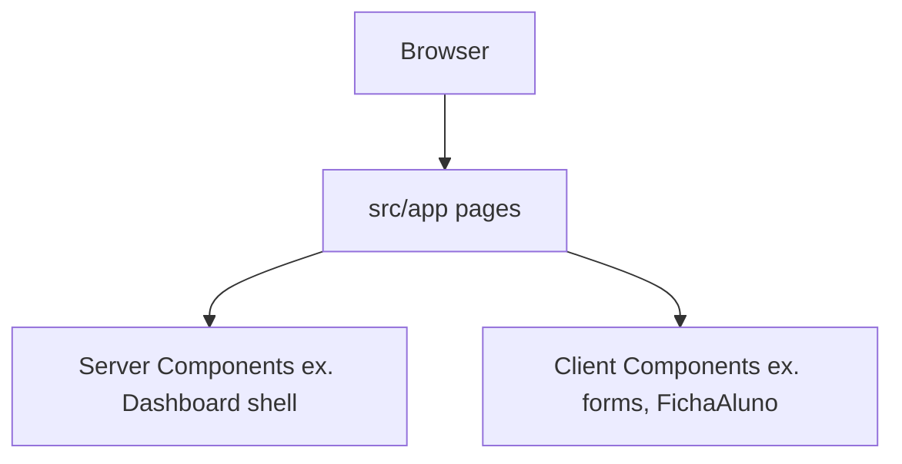

# Arquitetura

> Última atualização: 2026-10-09

## Stack (verificado em `package.json`)

| Camada           | Tecnologia                                                                | Versão (manifest)  |
| ---------------- | ------------------------------------------------------------------------- | ------------------ |
| Framework        | [Next.js](https://nextjs.org) (App Router)                                | 16.4.0             |
| UI               | React / React DOM                                                         | 19.3.0             |
| Estilo           | Tailwind CSS v4 (`@import "tailwindcss"`)                                 | ^4                 |
| Bundler (dev)    | Turbopack (`next dev`) + `@tailwindcss/turbopack` para CSS                | —                  |
| Linguagem        | TypeScript                                                                | ^5                 |
| Compilador React | `babel-plugin-react-compiler` (`reactCompiler: true` em `next.config.ts`) | 1.0.0              |
| Acesso e dados   | Supabase (`@supabase/ssr`, `@supabase/supabase-js`)                       | ver `package.json` |
| Validação        | Zod                                                                       | ver `package.json` |

Scripts: `npm run dev` | `build` | `start`.

## Configuração Next.js relevante

Arquivo `next.config.ts`:

- `reactCompiler: true`
- `cacheComponents: true`, `partialPrefetching: true`
- `experimental.agentFeedback: true`
- Regra Turbopack: arquivos `*.css` processados com `@tailwindcss/turbopack`

O ambiente local usa `NEXT_PUBLIC_SUPABASE_URL`, `NEXT_PUBLIC_SUPABASE_ANON_KEY` e `SUPABASE_SERVICE_ROLE_KEY`. A chave de serviço fica só no servidor.

## Estrutura de pastas (código-fonte)

```
academia-web/
├── src/app/              # App Router: páginas e layout raiz
│   ├── layout.tsx        # Fontes Google, metadata, globals.css
│   ├── page.tsx          # / — cadastro administrador
│   ├── login/page.tsx
│   ├── painel/page.tsx
│   ├── painel/alunos/page.tsx
│   ├── painel/alunos/novo/page.tsx
│   ├── painel/alunos/[id]/page.tsx
│   └── globals.css       # @theme tokens (cores, tipografia)
├── src/proxy.ts          # sessão do painel
├── src/lib/              # sessão Supabase, validação
├── src/components/
│   ├── acesso/           # login e cadastro do administrador
│   └── painel/           # casca do painel e dashboard
├── supabase/             # SQL das tabelas, funções e RLS
├── docs/                 # Documentação e PRDs (fora do runtime)
├── next.config.ts
├── tsconfig.json         # alias @/* → ./src/*
└── package.json
```

Alias de import: `@/components/...`, `@/app/...`.

## Camadas e responsabilidades



- **Páginas** (`src/app/**/page.tsx`): composição fina; exportam `metadata` onde necessário.
- **Server Components**: `Dashboard` consulta total, ativos, porcentagem e entradas do mês. Aulas, avaliações e catracas da mesma tela continuam ilustrativas.
- **Client Components**: formulários de acesso, o cadastro de aluno e a ficha (`FichaAluno`).
- **Sessão**: `src/proxy.ts` afasta quem não entrou de `/painel`. A página confirma que a pessoa está em administradores.

Não existem route handlers de API de negócio além de `/acesso/encerrar`, que encerra uma sessão que não é de administrador.

## Rotas e fluxos de navegação

| Path                  | Componente principal    | Comportamento                                                    |
| --------------------- | ----------------------- | ---------------------------------------------------------------- |
| `/`                   | `CadastroAdministrador` | Cria o primeiro administrador e entra no painel                  |
| `/login`              | `LoginAdministrador`    | Confere e-mail e senha; sair encerra a sessão                    |
| `/painel`             | `Dashboard`             | Total e ativos vêm dos alunos; o resto da tela segue ilustrativo |
| `/painel/alunos`      | lista                   | Busca e filtro de ativos ou inativos                             |
| `/painel/alunos/novo` | `CadastroAluno`         | Grava o aluno e limpa o formulário                               |
| `/painel/alunos/[id]` | `FichaAluno`            | Edita, inativa e reativa                                         |

Links cruzados: cadastro ↔ login via `next/link`.

## Design system (UI)

- **Tema**: classe `dark` no `<html>`; tokens CSS em `globals.css` (`@theme inline`) — superfícies, primary/secondary/error, escalas de texto (`font-headline-*`, `font-body-*`, `font-label-*`).
- **Fontes**: Space Grotesk (títulos/rótulos) e Plus Jakarta Sans (corpo), via `next/font/google` em `layout.tsx`.
- **Ícones**: Google Material Symbols Outlined (link externo no layout).
- **Espaçamento**: utilitários Tailwind custom (`space-lg`, `gutter`, etc., definidos no tema CSS).

Referências de layout Stitch/HTML ficam em `docs/prd/stitch_*` (design de referência, não runtime).

## Dependências externas em runtime

O navegador carrega Google Fonts e Material Symbols. O servidor fala com o Supabase para sessão, administrador e aluno.

## Documentação relacionada

- Produto e gap PRD vs código: [project-overview.md](./project-overview.md)
- Requisitos completos do painel: [prd/painel-administrador.md](./prd/painel-administrador.md)
- Onboarding local: [README.md](../README.md)

## Evolução ainda não implementada

A área de planos, pagamentos, agenda e avaliação médica continua no PRD geral. A ficha só reserva esses blocos, sem lançamento.
